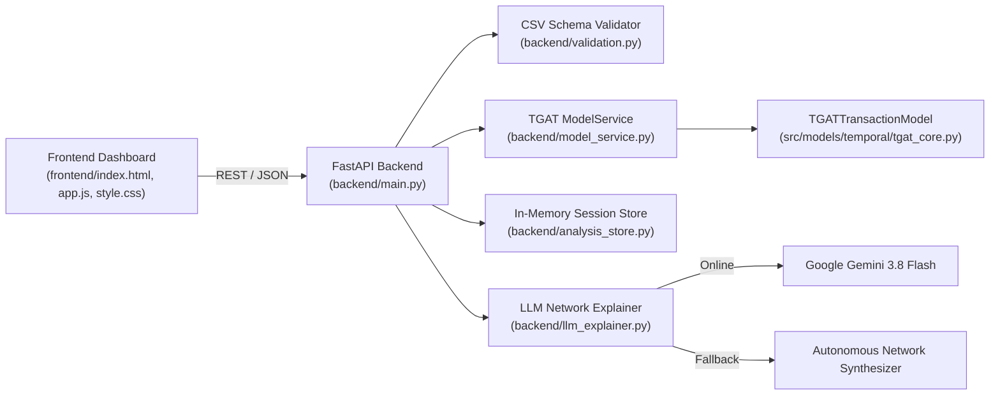

# Full Setup & Operations Guide

**Project:** Explainable Temporal Graph Attention Network (TGAT) for Financial Fraud Ring Detection  
**Stack:** PyTorch · FastAPI · Vanilla ES6 / HTML5 Canvas · Google Gemini (`google-genai`)  
**Default Model Checkpoint:** `results/tgat/model.pt`  
**Frozen Decision Threshold:** $\tau^* = 0.737155$ (selected on validation via `max_f1`)

---

## Table of Contents
1. [System Architecture Overview](#1-system-architecture-overview)
2. [Prerequisites](#2-prerequisites)
3. [Quick Start (Run the Backend & Dashboard)](#3-quick-start-run-the-backend--dashboard)
4. [LLM Explainer Configuration (`.env`)](#4-llm-explainer-configuration-env)
5. [Full Pipeline Setup From Scratch (Raw Dataset to Trained Model)](#5-full-pipeline-setup-from-scratch-raw-dataset-to-trained-model)
6. [Using the Dashboard & Supported Dataset Formats](#6-using-the-dashboard--supported-dataset-formats)
7. [API Endpoints Reference](#7-api-endpoints-reference)
8. [Verification & Test Suite](#8-verification--test-suite)
9. [Troubleshooting](#9-troubleshooting)

---

## 1. System Architecture Overview



### Repository Layout (Key Runtime & ML Files)
- `backend/main.py` — FastAPI entry point, static frontend mount, REST API routes, no-cache middleware.
- `backend/model_service.py` — Loads `results/tgat/model.pt`, `backend/scaler_params.json`, and `results/threshold_analysis/frozen_threshold.json`; runs causal batch & single-transaction inference with layer-wise attention extraction.
- `backend/validation.py` — Validates uploaded CSVs (up to **500 MB** / **10,000 rows** per interactive run) with automatic column alias mapping.
- `backend/analysis_store.py` — Session storage, graph topology builder, risk factors, and CSV export.
- `backend/llm_explainer.py` — Generates plain-English batch briefings, full connected-account narratives, and interactive Q&A using Gemini (`google-genai`) with automatic fallback.
- `frontend/` — Single-page investigation dashboard (`index.html`, `app.js`, `style.css`, `plots/`).
- `src/` — Data preprocessing, feature engineering, temporal split generation, TGAT model definition, training, baselines, and threshold analysis.
- `scripts/prepare_backend_data.py` — Generates `backend/scaler_params.json` and `backend/cases_data.json` from processed splits and predictions.

---

## 2. Prerequisites

| Requirement | Recommended Version / Detail |
|---|---|
| **OS** | Windows 10/11 (PowerShell) or Linux / macOS |
| **Python** | **3.11+** (tested on Python 3.11.9) |
| **Git** | Any recent version |
| **GPU (Optional)** | NVIDIA GPU with CUDA 12.4+ for accelerated PyTorch inference (`torch` automatically falls back to CPU if CUDA is unavailable) |
| **RAM** | 8 GB minimum for dashboard inference; **16–32 GB+** recommended if running the full 6.92M-row data preprocessing and training pipeline from scratch |
| **Gemini API Key (Optional)** | Free/paid key from [Google AI Studio](https://aistudio.google.com/apikey) for live Gemini 3.8 Flash explanations |

---

## 3. Quick Start (Run the Backend & Dashboard)

If your workspace already includes `results/` and `data/processed/` (skip to [Section 5](#5-full-pipeline-setup-from-scratch-raw-dataset-to-trained-model) if starting from a fresh git clone without those ignored folders):

### Step 1: Clone the Repository
```bash
git clone https://github.com/DakshDhaundiyal/explainable-financial-fraud-ring-detection.git
cd explainable-financial-fraud-ring-detection
git checkout ui-simplify
```

### Step 2: Create and Activate a Virtual Environment (`.venv`)

**Windows (PowerShell):**
```powershell
python -m venv .venv
.\.venv\Scripts\Activate.ps1
```
*(If PowerShell blocks script execution, you can either run `Set-ExecutionPolicy -Scope CurrentUser RemoteSigned` or invoke `.venv\Scripts\python.exe` directly without activating.)*

**macOS / Linux (Bash/Zsh):**
```bash
python3 -m venv .venv
source .venv/bin/activate
```

### Step 3: Install Python Dependencies
```bash
pip install --upgrade pip
pip install -r requirements.txt
```

If you also plan to run the graph analytics scripts (`src/graph/`) or the FastAPI `TestClient` integration tests, install `httpx` and `networkx` (if not already pulled in):
```bash
pip install httpx networkx
```

> **Optional GPU Acceleration (CUDA 12.4):**  
> By default `pip install -r requirements.txt` installs standard PyTorch. For NVIDIA CUDA 12.4 acceleration:
> ```bash
> pip install torch>=2.6.0 --index-url https://download.pytorch.org/whl/cu124
> ```

### Step 4: Configure Environment Variables (`.env`)
Create a `.env` file in the project root from `.env.example`:

**Windows (PowerShell):**
```powershell
Copy-Item .env.example .env
```

**macOS / Linux:**
```bash
cp .env.example .env
```

Open `.env` and set your Gemini API key (see [Section 4](#4-llm-explainer-configuration-env) for details):
```env
GEMINI_API_KEY=your_actual_gemini_api_key_here
```

### Step 5: Verify Required Runtime Artifacts Exist
Before starting the server, confirm these files are present:

| Artifact | Purpose | Required? |
|---|---|---|
| `results/tgat/model.pt` | Canonical trained TGAT weights (`68,319` bytes) | **Yes** |
| `results/threshold_analysis/frozen_threshold.json` | Validation-frozen threshold (`0.737155`) | **Yes** |
| `backend/scaler_params.json` | Train-only feature mean/scale parameters | **Yes** (tracked in Git) |
| `backend/cases_data.json` | Curated fraud ring case studies | Recommended (tracked in Git) |
| `results/threshold_analysis/tgat/test_at_frozen_threshold.json`, `results/tgat/metrics.json`, `results/baselines/*`, `results/ablations/*` | Metrics & **Compare models** tab | Required for `/api/metrics`, `/api/threshold`, `/api/ablations` |
| `data/processed/temporal_gnn/test.csv` & `results/tgat/test_predictions.csv` | Built-in **Run demo** batches & initial neighbor seeding | Required for `/api/analysis/sample` |

*(If `results/` or `data/` are empty because `.gitignore` excludes them, follow [Section 5](#5-full-pipeline-setup-from-scratch-raw-dataset-to-trained-model) or extract your experimental `results` archive into the repo root.)*

### Step 6: Start the Backend & Dashboard Server

**Windows (PowerShell):**
```powershell
.\.venv\Scripts\python.exe -m uvicorn backend.main:app --host 127.0.0.1 --port 8000
```

**macOS / Linux:**
```bash
.venv/bin/python -m uvicorn backend.main:app --host 127.0.0.1 --port 8000
```

Wait for `Application startup complete. Uvicorn running on http://127.0.0.1:8000`.

### Step 7: Open the Application
- **Investigation Dashboard:** [http://127.0.0.1:8000](http://127.0.0.1:8000)
- **Interactive Swagger API Docs:** [http://127.0.0.1:8000/docs](http://127.0.0.1:8000/docs)
- **Health Check:** [http://127.0.0.1:8000/api/health](http://127.0.0.1:8000/api/health)

Expected `/api/health` response:
```json
{
  "status": "healthy",
  "service": "Explainable TGAT Fraud Detection Engine",
  "model_architecture": "Temporal Graph Attention Network (TGAT)",
  "device": "cuda",
  "feature_dim": 26,
  "frozen_threshold": 0.7371551061535726,
  "checkpoint_file": "results/tgat/model.pt"
}
```

---

## 4. LLM Explainer Configuration (`.env`)

The LLM explainer (`backend/llm_explainer.py`) translates TGAT outputs, connected counterparty risks, and laundering topologies into plain-English case notes and answers interactive follow-up questions.

1. **Get an API key** at [https://aistudio.google.com/apikey](https://aistudio.google.com/apikey).
2. **Add it to `.env`** in the repository root (`.env` is listed in `.gitignore` and will never be committed):
   ```env
   GEMINI_API_KEY=your_key_here
   ```
   `backend/llm_explainer.py` automatically reads `.env` at runtime if `GEMINI_API_KEY` is not already exported in your shell environment.
3. **Resilient Dual-Engine Fallback:**
   - **Primary Engine:** Calls `gemini-3.8-flash` via the official `google-genai` SDK.
   - **Automatic Fallback:** If `GEMINI_API_KEY` is unset, offline, or returns a quota/credit error (such as `402 RESOURCE_EXHAUSTED`), the backend automatically switches to the built-in **Autonomous Network Synthesizer** so the UI, narratives, and Q&A continue functioning with zero errors.
   - Explanations are cached in memory per `(session_id, account_id)` to avoid duplicate API requests.

---

## 5. Full Pipeline Setup From Scratch (Raw Dataset to Trained Model)

> **Why is this needed on a clean clone?**  
> `.gitignore` excludes `data/raw/*`, `data/processed/*`, `data/graphs/*`, and `results/` due to file sizes (600 MB–1.5 GB per CSV). If you do not have a pre-generated `results/` archive, run the full pipeline below to rebuild everything from the raw dataset.

### 5.1 Download the Dataset
1. Download the **IBM Anti-Money Laundering (AML)** transaction dataset (`LI-Small_Trans.csv`, ~6.92M transactions).
2. Place the file at:
   ```
   data/raw/LI-Small_Trans.csv
   ```

### 5.2 Run Data Preprocessing & Feature Engineering
Execute each stage sequentially from the repository root:

```bash
# 1. Clean raw CSV, deduplicate, and parse timestamps
#    Input:  data/raw/LI-Small_Trans.csv
#    Output: data/processed/processed_transactions.csv
python src/data/preprocess.py

# 2. Engineer 11 current-transaction tabular features
#    Input:  data/processed/processed_transactions.csv
#    Output: data/processed/feature_engineered_transactions.csv
python src/features/feature_engineering.py

# 3. Sort chronologically and compute relative Temporal Seconds
#    Input:  data/processed/feature_engineered_transactions.csv
#    Output: data/processed/temporal_transactions.csv
python src/data/temporal_processing.py

# 4. Split chronologically into train / validation / test / future
#    Output: data/processed/splits/{train,validation,test,future}.csv
python src/data/temporal_split.py

# 5. Deduplicate split records for modeling
#    Output: data/processed/modeling_splits/{train,validation,test,future}.csv
python src/data/create_modeling_splits.py

# 6. (Optional) Verify strict temporal boundaries & zero target leakage
python src/data/leakage_validation.py

# 7. Build leakage-safe temporal window state features (27 features + metadata.json)
#    Output: data/processed/temporal_gnn/{train,validation,test,future}.csv
python -m src.models.temporal.temporal_dataset --validate
```

### 5.3 Train the Canonical TGAT Model & Freeze Threshold
```bash
# 8. Train TGAT on chronological stream (saves results/tgat/model.pt, metrics.json, and predictions)
python -m src.models.temporal.train_tgat \
  --results-dir results/tgat \
  --epochs 3 \
  --batch-size 256 \
  --neighbor-k 10 \
  --negative-ratio 20 \
  --lr 0.001

# 9. Select and freeze operating threshold exclusively on validation split
python -m src.analysis.threshold_analysis \
  --predictions results/tgat/validation_predictions.csv \
  --test-predictions results/tgat/test_predictions.csv \
  --results-dir results/threshold_analysis \
  --criterion max_f1

# 10. Generate backend scaler parameters and curated case studies
python scripts/prepare_backend_data.py
```

### 5.4 (Optional) Baselines, Ablations & Future Generalization
For reproducing the 4 baseline models (`logistic_regression`, `xgboost`, `temporal_xgboost`, `static_gcn`), the 15 ablation studies (`results/ablations/`), and Phase 11 future evaluation, refer to [docs/phase_9_11_runbook.md](phase_9_11_runbook.md).

---

## 6. Using the Dashboard & Supported Dataset Formats

### 6.1 Running Built-In Demo Batches
1. Open [http://127.0.0.1:8000](http://127.0.0.1:8000).
2. Choose either **50 transactions** or **1,000+ accounts** and click **Run demo**.
3. Review:
   - **Verdict Banner & Metric Tiles** — Total transactions, flagged rings, normal counts, and FP reduction vs XGBoost.
   - **✨ AI Investigation Briefing** — Full-batch plain-English summary right above the graph canvas.
   - **Connected Accounts Graph** — Live force-directed network with animated fund-flow particles and risk filter slider (`All`, `Watch ≥ 0.40`, `Alert line ≥ 0.74`).
   - **Selected Account Panel** — Click any node (e.g., central hub `8091C4A00`) to inspect its **Why** breakdown, **✨ AI Investigation Narrative** covering all connected counterparties, **Transactions**, **Connections**, and the **Ask AI about this network** input box.
4. Switch to the **Compare models** tab in the top bar to view TGAT vs Logistic Regression, Static GCN, XGBoost, and Temporal XGBoost.

### 6.2 Uploading Custom Datasets (Up to 500 MB)
You can drag and drop any `.csv` transaction dataset up to **500 MB** (`MAX_FILE_SIZE_BYTES` in `backend/validation.py`). To keep browser graph rendering responsive, interactive batch scoring processes up to the first **10,000 rows** (`MAX_UPLOAD_ROWS`).

The validator supports:
1. **Raw IBM AML Schema:** `Timestamp`, `From Bank`, `From Account`, `To Bank`, `To Account`, `Amount Received`, `Receiving Currency`, `Amount Paid`, `Payment Currency`, `Payment Format` (+ optional `Is Laundering`).
2. **Processed Temporal GNN Schema:** `From Account`, `To Account`, `Timestamp`, `Amount Received`, `Amount Paid` (+ optional precomputed temporal features).
3. **Auto-Mapped External Datasets:** Automatically resolves common column names across real-world datasets such as **Ethereum Phishing/Scam** (`from_address`, `to_address`, `value`, `timestamp`), **PaySim** (`step`, `nameOrig`, `nameDest`, `amount`), and generic transaction logs (`sender`/`source`/`src`, `receiver`/`target`/`dest`, `time`/`date`/`datetime`/`block_timestamp`, `amount`/`value`/`amt`). Numeric Unix timestamps (seconds or milliseconds) and simulation steps are converted automatically.

---

## 7. API Endpoints Reference

Interactive docs are served at [http://127.0.0.1:8000/docs](http://127.0.0.1:8000/docs).

| Method | Endpoint | Description |
|---|---|---|
| `GET` | `/api/health` | Service health, device (`cuda`/`cpu`), feature count (`26`), frozen threshold |
| `GET` | `/api/metrics` | TGAT frozen-threshold metrics & all baseline comparison metrics |
| `GET` | `/api/threshold` | Validation threshold sweep data & precision/FP tradeoff stats |
| `GET` | `/api/ablations` | All 15 TGAT ablation experiment results |
| `GET` | `/api/cases` & `/api/cases/{case_id}` | Curated forensic fraud ring case studies |
| `POST` | `/api/predict` | Single-transaction live TGAT scoring with attention weights |
| `POST` | `/api/analysis/upload` | Upload & validate raw CSV bytes |
| `POST` | `/api/analysis/validate` | Validate CSV text content and inspect detected schema/errors |
| `POST` | `/api/analysis/run` | Score chronological transaction CSV and create an investigation session |
| `GET` | `/api/analysis/sample` | Extract a representative demo batch (`?count=50` to `2000`) |
| `GET` | `/api/analysis/overview` | Session KPIs, score distribution, and AI executive briefing |
| `GET` | `/api/analysis/sessions` | List all completed analysis sessions in memory |
| `GET` | `/api/analysis/{session_id}/results` | Paginated, sorted, searchable transaction results |
| `GET` | `/api/analysis/{session_id}/graph` | Directed graph nodes and edges for visualization |
| `GET` | `/api/analysis/{session_id}/transaction/{tx_id}` | Per-transaction attention weights & factual evidence |
| `GET` | `/api/analysis/{session_id}/account/{account_id}` | Account history, counterparties, risk factors, & AI narrative |
| `POST` | `/api/analysis/{session_id}/account/{account_id}/ask` | Interactive follow-up Q&A for a specific account network |
| `GET` | `/api/analysis/{session_id}/export` | Download scored results as CSV |

---

## 8. Verification & Test Suite

Run all tests from the repository root using the virtual environment Python:

```powershell
# 1. Core TGAT architecture & attention normalization smoke test
.\.venv\Scripts\python.exe tests_tgat.py

# 2. Temporal causality & micro-batch isolation regression tests (Phase 9)
.\.venv\Scripts\python.exe -c "import tests_phase9; tests_phase9.test_no_time_encoding_preserves_neighbor_mask(); tests_phase9.test_single_layer_variant(); tests_phase9.test_no_neighbor_batch_has_zero_valid_deltas(); tests_phase9.test_same_timestamp_micro_batches_share_pre_state(); print('Phase 9 tests passed!')"

# 3. Backend API & Batch Analysis / LLM Explainer integration tests (11 tests total)
.\.venv\Scripts\python.exe -m unittest tests_backend.py tests_analysis.py
```

*(Note: `tests_backend.py` and `tests_analysis.py` require `results/tgat/model.pt`, `results/threshold_analysis/`, `results/baselines/`, `results/ablations/`, and `data/processed/temporal_gnn/test.csv` to be present.)*

---

## 9. Troubleshooting

| Issue | Cause & Solution |
|---|---|
| **`Address already in use` on port `8000`** | Another process or previous `uvicorn` instance is bound to `127.0.0.1:8000`. Stop the existing process or run on another port: `--port 8001`. |
| **UI updates not showing in browser** | Perform a hard reload (`Ctrl + F5` on Windows/Linux, `Cmd + Shift + R` on macOS). The server also sets `Cache-Control: no-cache, no-store, must-revalidate` headers via middleware. |
| **`FileNotFoundError` for `results/tgat/model.pt` or `test.csv`** | `results/` and `data/` are git-ignored. Restore them from your project archive or run the pipeline in [Section 5](#5-full-pipeline-setup-from-scratch-raw-dataset-to-trained-model). |
| **LLM badge shows `Autonomous Network Synthesizer` instead of `Gemini 3.8 Flash`** | Either `GEMINI_API_KEY` is missing in `.env`, the machine is offline, or the Gemini API project returned `402 RESOURCE_EXHAUSTED` (credits depleted) / quota limit. Add a valid funded/free-tier key from AI Studio to `.env` and restart `uvicorn`. |
| **`Uploaded file failed schema validation`** | Verify your CSV contains non-empty sender, receiver, valid timestamp/step, and positive numeric amount columns (headers are auto-mapped for IBM AML, Ethereum, PaySim, and standard names). |
| **`No module named 'httpx'` when running tests** | Run `pip install httpx` inside `.venv` (`fastapi.testclient.TestClient` requires `httpx`). |

