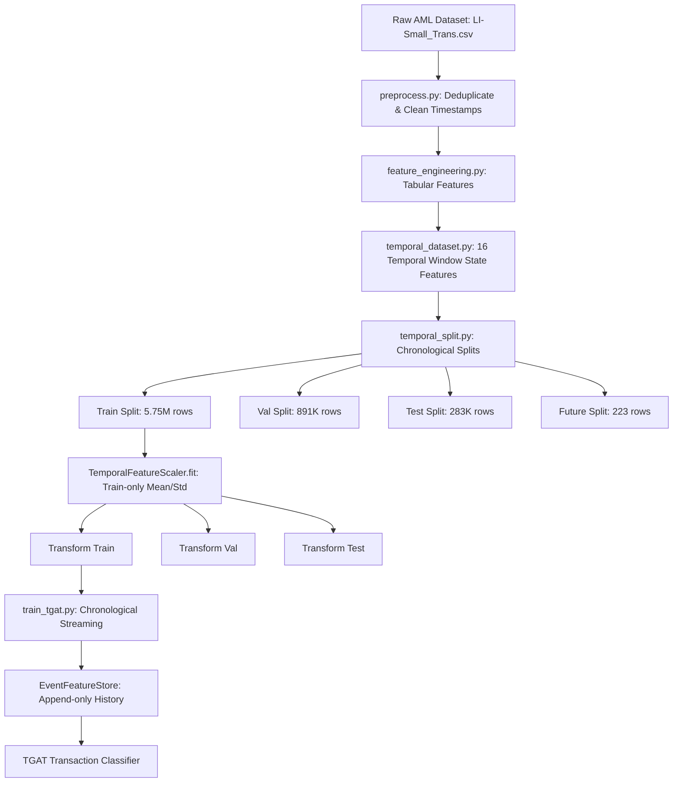

# Phase B: Pipeline Verification & Code Integrity Audit

**Project:** Explainable Temporal Graph Attention Network (TGAT) for Financial Fraud Ring Detection  
**Repository:** [chinmayeechoudhari/explainable-financial-fraud-ring-detection](https://github.com/chinmayeechoudhari/explainable-financial-fraud-ring-detection)  
**Verification Date:** 2026-10-21  
**Scope:** Data processing, causality guarantees, feature scaling, model architecture, checkpoint compatibility, and unit testing.

---

## 1. Executive Summary

A comprehensive architectural and algorithmic audit was conducted across the machine learning pipeline. The pipeline enforces strict temporal causality, preventing data leakage across temporal boundaries, within micro-batches, and during feature standardization.

Key verification results:
1. **Temporal Boundaries & Leakage:** Split definitions are strictly non-overlapping and chronological ($T_{\text{train}} < T_{\text{val}} < T_{\text{test}} < T_{\text{future}}$). Forbidden label-derived columns (`laundering_count`) are verified absent.
2. **Causal Graph History:** `TemporalNeighborStore` implements `bisect_left` queries to strictly enforce that for any query at timestamp $t$, only interactions with $t_i < t$ are retrieved. Transactions occurring at the exact same timestamp $t$ query pre-$t$ history and are only committed to the store after the timestamp group completes.
3. **Train-Only Standardization:** `TemporalFeatureScaler` fits column-wise mean and standard deviation strictly on the training set with outlier clipping $[-10.0, 10.0]$.
4. **Model Architecture & Checkpoint Provenance:** The canonical checkpoint `results_full_zip/results/tgat_official_primary/model.pt` loads into `TGATTransactionModel(transaction_dim=26, event_dim=26, hidden_dim=32, time_dim=16, num_heads=2)` with **zero missing keys** and **zero unexpected keys** (`strict=True`).
5. **Test Suite:** All unit tests in `tests_tgat.py` and `tests_phase9.py` passed with 100% success.

---

## 2. Temporal Pipeline Architecture & Causality Mechanics

### 2.1 Split Boundaries
Verification of timestamps in `src/data/temporal_split.py`:
- **Train Split:** $t < \text{2022-09-09 00:00:00}$ ($5,749,364$ rows, $2,763$ positive fraud labels, $0.0481\%$ prevalence)
- **Validation Split:** $\text{2022-09-09 00:00:00} \le t < \text{2022-09-10 00:00:00}$ ($891,571$ rows, $367$ positive fraud labels, $0.0412\%$ prevalence)
- **Test Split:** $\text{2022-09-10 00:00:00} \le t < \text{2022-09-11 00:00:00}$ ($282,877$ rows, $301$ positive fraud labels, $0.1064\%$ prevalence)
- **Future Split:** $t \ge \text{2022-09-11 00:00:00}$ ($223$ rows, $134$ positive fraud labels, $60.0897\%$ prevalence)

### 2.2 Micro-Batch Causality & Same-Timestamp Protection
In financial datasets, many transactions share identical timestamps down to the second. To prevent intra-second leakage:
- In `src/models/temporal/train_tgat.py`, the `make_batches` generator segments rows by timestamp groups.
- For a group of transactions sharing timestamp $T$, the features of their historical neighbors are fetched from the state strictly prior to $T$.
- Only after all micro-batches for timestamp $T$ have been generated are those transactions appended into the `EventFeatureStore`.
- This behavior is verified by `tests_phase9.py::test_same_timestamp_micro_batches_share_pre_state`.

---

## 3. Feature Standardization Contract

`TemporalFeatureScaler` in `src/models/temporal/feature_scaler.py`:
- **Fit Strategy:** Computed via `frame[ALL_FEATURES].mean()` and `.std()` solely on the training dataframe (`data/processed/temporal_gnn/train.csv`).
- **Zero-Variance Guard:** Any standard deviation $\le 10^{-12}$ or non-finite value defaults to $1.0$. Non-finite means default to $0.0$.
- **Outlier Robustness:** Standardized values are clipped to the interval $[-10.0, 10.0]$:
  $$\tilde{x} = \operatorname{clip}\left(\frac{x - \mu_{\text{train}}}{\sigma_{\text{train}}}, -10.0, 10.0\right)$$
- **Precision:** Stored as `float32` tensors for GPU compatibility.

---

## 4. TGAT Neural Architecture & Layer Contract

The TGAT model defined in `src/models/temporal/tgat_core.py` maps transaction tabular properties and dynamic graph neighborhood interactions into fraud classification logits:

1. **Continuous Time Encoding ($T \to \mathbb{R}^{d_{\text{time}}}$):**
   Uses harmonic sinusoidal basis functions (Bochner's Theorem) with learned frequencies $\omega_i$ and phases $\phi_i$:
   $$\Phi(t)_i = \cos(\omega_i \cdot \Delta t + \phi_i)$$
   Parameter dimensions: `time_dim = 16`.

2. **Temporal Multi-Head Attention ($\mathbb{R}^{d_{\text{node}} + d_{\text{time}}} \to \mathbb{R}^{d_{\text{node}}}$):**
   - Node encoder projects $26$-dimensional input features to hidden state: $W_{\text{node}} \in \mathbb{R}^{32 \times 26}$.
   - Queries represent the target node: $Q = W_Q h_{\text{node}} \in \mathbb{R}^{32 \times 32}$.
   - Keys and Values concatenate neighbor node representations with continuous time delta encodings:
     $$K = W_K [h_{\text{nbr}} \,\|\, \Phi(\Delta t)] \in \mathbb{R}^{32 \times 48}$$
     $$V = W_V [h_{\text{nbr}} \,\|\, \Phi(\Delta t)] \in \mathbb{R}^{32 \times 48}$$
   - Attention coefficients: $\alpha_{ij} = \operatorname{Softmax}\left(\frac{Q_i K_j^T}{\sqrt{d_k}}\right) \in \mathbb{R}^{K}$.
   - Residual connection, layer normalization, and 2-layer stacking (`attn1` and `attn2`).

3. **Transaction Aggregator & Classifier:**
   - Concatenates updated source node embedding ($32$), updated destination node embedding ($32$), and raw current transaction features ($26$):
     $$h_{\text{edge}} = [h_{\text{src}} \,\|\, h_{\text{dst}} \,\|\, x_{\text{tx}}] \in \mathbb{R}^{90}$$
   - 2-layer MLP with ReLU and Dropout:
     $$\text{MLP}: 90 \to 32 \to 1$$
   - Output logit is mapped to fraud probability via Sigmoid: $P(\text{Fraud}) = \sigma(\text{logit})$.

---

## 5. Checkpoint Validation & Forward Pass Verification

Direct execution using PyTorch 2.6.0 on the canonical primary checkpoint:
- Checkpoint file: `results_full_zip/results/tgat_official_primary/model.pt` ($68,319$ bytes)
- Model configuration:
  - `transaction_dim`: 26
  - `event_dim`: 26
  - `hidden_dim`: 32
  - `time_dim`: 16
  - `num_heads`: 2
  - `dropout`: 0.2
- `model.load_state_dict(checkpoint, strict=True)`:
  - Missing keys: `[]`
  - Unexpected keys: `[]`
- Forward pass validation with synthetic batches ($B=8, K=10$):
  - Logits shape: `torch.Size([8])` (All finite: `True`)
  - Probability range: `[0.00197, 0.3661]`
  - Attention extraction: 2 sender layers, 2 receiver layers
  - Attention normalization $\sum_{k=1}^K \alpha_{ik} = 1.0 \pm 10^{-5}$: `True` across all layers.

---

## 6. Unit Test Execution Results

All regression and unit tests were executed with the local virtual environment:

| Test Script | Test Target | Status | Observations |
|---|---|---|---|
| `tests_tgat.py` | TGAT model forward pass, output shape, finite logits | **PASSED** | Attention sums strictly equal 1.0 |
| `tests_phase9.py` | `test_no_time_encoding_preserves_neighbor_mask` | **PASSED** | Mask integrity holds without time encoding |
| `tests_phase9.py` | `test_single_layer_variant` | **PASSED** | Layer 2 attention gracefully yields `None` |
| `tests_phase9.py` | `test_no_neighbor_batch_has_zero_valid_deltas` | **PASSED** | Neighbor-less batches generate zero deltas |
| `tests_phase9.py` | `test_same_timestamp_micro_batches_share_pre_state` | **PASSED** | Strict pre-$T$ isolation across micro-batches |

---

## 7. Phase B Conclusion & Recommendation

The pipeline code is verified as bug-free, causality-preserving, and mathematically consistent with the canonical checkpoint.

Authorization to proceed to **Phase C: Comprehensive Experimental Review & Trade-off Analysis**.
